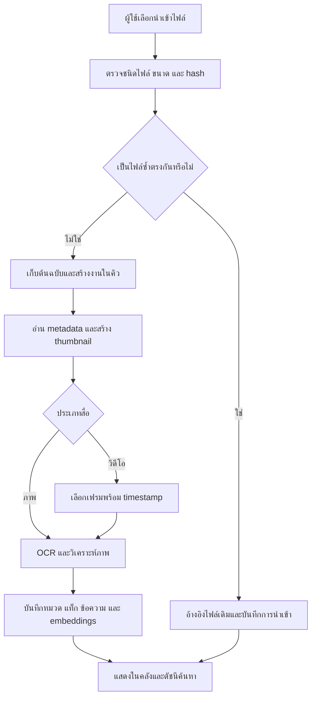

# แผนโครงการ AI Media Organizer

คลังภาพและวิดีโอส่วนตัวที่จัดหมวดหมู่อัตโนมัติ และค้นหาได้ด้วยภาษาธรรมชาติ

- วันที่จัดทำ: 20 ตุลาคม 2026
- สถานะ: แผนพัฒนา ยังไม่ได้เริ่มสร้างระบบ
- เป้าหมาย: ใช้จัดการสื่อส่วนตัวจริง และเป็นผลงานบน GitHub สำหรับสมัครงาน

## 1. ปัญหาที่ต้องการแก้

ในมือถือมีภาพถ่าย ภาพหน้าจอ และวิดีโอจำนวนมากที่ไม่ได้แยกหมวดหมู่ เมื่ออยากหาไฟล์เดิมมักจำชื่อไฟล์หรือวันที่ไม่ได้ และต้องเลื่อนดูด้วยตัวเอง การจัดหมวดทีละไฟล์ใช้เวลาและทำต่อเนื่องได้ยาก

ระบบควรช่วยให้ผู้ใช้หาไฟล์เจอโดยไม่ต้องจัดทุกไฟล์เอง พร้อมรักษาต้นฉบับและให้ผู้ใช้แก้ผลการวิเคราะห์ได้

## 2. เป้าหมายและขอบเขต

### เป้าหมายหลัก

1. นำเข้าภาพและวิดีโอหลายไฟล์ และติดตามสถานะประมวลผลได้
2. จัดหมวดและเพิ่มแท็กอัตโนมัติ โดยหนึ่งไฟล์มีได้หลายหมวด
3. ค้นหาจากข้อความในภาพ ความหมายของภาพ และข้อมูลไฟล์ร่วมกัน
4. ค้นหาวิดีโอแล้วเปิดไปยังช่วงเวลาที่เกี่ยวข้องได้
5. ประมวลผลเฉพาะไฟล์ใหม่ และทำงานต่อได้หลังระบบหยุด
6. เก็บต้นฉบับไว้ และไม่ลบหรือย้ายไฟล์ต้นทางอัตโนมัติ

### สมมติฐานสำหรับเวอร์ชันแรก

- เริ่มจากผู้ใช้คนเดียว และเว็บที่รองรับหน้าจอมือถือ
- ผู้ใช้เลือกนำเข้าไฟล์เองก่อน ส่วนการวิเคราะห์หลังนำเข้าเป็นอัตโนมัติ
- เริ่มทดสอบด้วยสื่อประมาณ 100–300 ไฟล์ที่ผู้ใช้อนุญาต
- รองรับคำค้นภาษาไทยและอังกฤษ โดยต้องประเมินคุณภาพจริงก่อนเลือกโมเดล
- เก็บไฟล์บนเครื่องหรือเซิร์ฟเวอร์ที่ผู้ใช้ควบคุมเป็นค่าเริ่มต้น
- ยังไม่สมมติว่าเชื่อม Google Photos, iCloud หรือคลังรูปทั้งเครื่องได้แล้ว

## 3. ตัวอย่างการใช้งาน

| สถานการณ์ | สิ่งที่ผู้ใช้ทำ | ผลลัพธ์ที่ต้องการ |
| --- | --- | --- |
| หาภาพเอกสาร | ค้นว่า “บิลค่าซ่อมรถ” | พบภาพที่เกี่ยวข้อง พร้อมข้อความที่ตรวจพบ |
| หาภาพจากเนื้อหา | ค้นว่า “แมวนอนบนโซฟา” | พบภาพที่มีลักษณะใกล้เคียง แม้ไม่มีข้อความในภาพ |
| หาภาพตามเวลา | เลือกหมวดท่องเที่ยวและช่วงวันที่ | เห็นผลลัพธ์เฉพาะไฟล์ที่มีข้อมูลเวลาตรงเงื่อนไข |
| หาช่วงในวิดีโอ | ค้นว่า “ทะเลตอนพระอาทิตย์ตก” | เห็นภาพตัวอย่างและเวลาที่กดเปิดวิดีโอต่อได้ |
| จัดการไฟล์ซ้ำ | เปิดรายการไฟล์ซ้ำ | เห็นกลุ่มไฟล์ที่เนื้อหาตรงกันและตรวจสอบได้ |
| แก้หมวดผิด | เปลี่ยนหมวดหรือแท็ก | ระบบเก็บการแก้ไขไว้ และไม่เขียนทับด้วยงานประมวลผลเดิม |

หมวดเริ่มต้น: ภาพหน้าจอ / เอกสารและใบเสร็จ / อาหาร / ท่องเที่ยว / สัตว์เลี้ยง / งาน / อื่น ๆ

แท็กใช้ระบุรายละเอียด เช่น ทะเล กลางคืน เมนูอาหาร หรือแมว และผู้ใช้แก้ไขได้ การแสดงผลใช้อัลบั้มเสมือนจากข้อมูลหมวดและแท็ก โดยไม่ต้องย้ายไฟล์ต้นฉบับ

## 4. กระบวนการ automation

### หลักการทำงานเบื้องหลัง

- แยกการรับไฟล์ออกจากงานวิเคราะห์ที่ใช้เวลานาน
- แสดงสถานะ เช่น รอคิว กำลังประมวลผล สำเร็จ และล้มเหลว
- เก็บสถานะในที่จัดเก็บถาวร และตรวจงานค้างเมื่อเริ่มระบบใหม่
- ออกแบบงานให้รันซ้ำได้โดยไม่สร้างข้อมูลหรือไฟล์อนุพันธ์ซ้ำ
- ใช้ hash ของเนื้อหาเพื่อตรวจไฟล์ซ้ำตรงกัน โดยชื่อไฟล์ต่างกันได้
- บันทึกเวอร์ชันโมเดลและขั้นตอนที่ทำแล้ว เพื่อเลือกประมวลผลใหม่เฉพาะส่วน
- ลองใหม่เฉพาะข้อผิดพลาดชั่วคราว โดยมีจำนวนครั้งจำกัด
- ไฟล์เสียหนึ่งไฟล์ต้องไม่หยุดการประมวลผลทั้งชุด
- ให้ผู้ใช้ค้นหาไฟล์ที่ทำเสร็จแล้วได้ระหว่างที่ไฟล์อื่นยังอยู่ในคิว

## 5. การค้นหา

ใช้การค้นหาแบบผสมจากสามแหล่ง:

1. **ข้อความ:** OCR ชื่อไฟล์ หมวด และแท็ก
2. **ความหมาย:** embeddings ของภาพหรือเฟรมวิดีโอ เพื่อค้นจากคำบรรยาย
3. **ตัวกรอง:** ประเภทสื่อ ช่วงวันที่ และหมวด

ระบบต้องรวมผลและจัดอันดับ โดยปรับวิธีรวมคะแนนจากชุดทดสอบจริง ไม่สมมติว่าคะแนนจากแต่ละวิธีเทียบกันได้ทันที

### สิ่งที่ผลการค้นหาต้องแสดง

- ภาพตัวอย่าง ประเภทสื่อ และข้อมูลวันที่ที่มีอยู่
- เหตุผลอย่างย่อ เช่น พบข้อความตรงคำค้น หรือภาพมีเนื้อหาใกล้เคียง
- ช่วงเวลาที่เกี่ยวข้องสำหรับวิดีโอ โดยรวมเฟรมใกล้กันเพื่อลดผลลัพธ์ซ้ำ
- เมื่อค้นไม่พบ ให้แสดงสถานะตรงไปตรงมาและเปิดให้ปรับตัวกรอง

### การจัดการวันที่

- แยกวันที่ถ่าย วันที่ไฟล์ถูกแก้ไข และวันที่นำเข้า
- ใช้วันที่ถ่ายเมื่อมี metadata ที่อ่านได้ พร้อมเก็บแหล่งที่มา
- หากไม่ทราบวันที่ถ่าย ให้แสดงว่าไม่ทราบ และให้เลือกกรองตามวันที่นำเข้าแทน
- ไม่ให้ AI เดาวันที่ถ่ายจากเนื้อหาในภาพ

## 6. ขอบเขต MVP

### ต้องมี

- [ ] เว็บคลังสื่อที่ใช้งานบนมือถือได้
- [ ] นำเข้าหลายไฟล์ พร้อมรายงานไฟล์ที่ไม่รองรับหรือประมวลผลไม่ได้
- [ ] กำหนดชนิดไฟล์และเพดานขนาดที่รองรับอย่างชัดเจนก่อนเริ่มพัฒนา
- [ ] คิวงานและหน้าติดตามความคืบหน้า
- [ ] Thumbnail และหน้าดูรายละเอียดไฟล์
- [ ] หมวดและแท็กอัตโนมัติ พร้อมแก้ไขด้วยตนเอง
- [ ] OCR ภาษาไทยและอังกฤษจากภาพและเฟรมที่เลือก
- [ ] ค้นหาจากข้อความและความหมาย พร้อมตัวกรอง
- [ ] ตรวจไฟล์ซ้ำตรงกันด้วย hash
- [ ] เลือกเฟรมวิดีโอ เก็บ timestamp และเปิดไปยังช่วงที่พบ
- [ ] เก็บต้นฉบับ และมีวิธีเริ่มงานที่ล้มเหลวใหม่

### ทำหลัง MVP

- ซิงก์ไฟล์ใหม่จากมือถือหรือแหล่งสำรองที่เลือก
- ถอดเสียงและค้นหาจากเสียงในวิดีโอ
- ตรวจภาพคล้ายกัน ภาพที่ถูกย่อขนาด หรือภาพต่อเนื่อง
- เลือกเฟรมจากการเปลี่ยนฉากเพื่อเพิ่มโอกาสพบเหตุการณ์สั้น ๆ
- แนะนำรายการให้ผู้ใช้ตรวจเพื่อลดพื้นที่จัดเก็บ
- เรียนรู้จากการแก้หมวดของผู้ใช้ โดยกำหนดวิธีประเมินก่อนเปิดใช้

การเลือกเฟรมเป็นช่วงอาจพลาดเหตุการณ์สั้นในวิดีโอ จึงต้องระบุข้อจำกัดนี้ในหน้าใช้งานและเอกสาร

## 7. ข้อจำกัดและทางเลือกสำหรับมือถือ

เว็บบนมือถือไม่สามารถเข้าถึงคลังรูปทั้งเครื่องและอัปโหลดเบื้องหลังได้ตลอดเวลา จึงแยกการนำเข้าจากการประมวลผลอัตโนมัติให้ชัดเจน

| ทางเลือก | เหมาะกับ | สิ่งที่ต้องตรวจสอบ |
| --- | --- | --- |
| เลือกอัปโหลดผ่านเว็บ | MVP และการทดสอบระบบค้นหา | การเลือกหลายไฟล์ ขนาดไฟล์ และข้อจำกัดเบราว์เซอร์ |
| แอปมือถือ | ต้องการเข้าถึงคลังรูปและนำเข้าเพิ่ม | สิทธิ์เข้าถึงรูป ข้อจำกัด background และความต่างระหว่าง Android/iOS |
| เชื่อมแหล่งสำรอง | ผู้ใช้มีบริการสำรองภาพอยู่แล้ว | ขอบเขต API สิทธิ์ และข้อจำกัดปัจจุบันของผู้ให้บริการ |
| นำเข้าจากโฟลเดอร์หรือไฟล์ export | มีไฟล์สำรองอยู่บนคอมพิวเตอร์ | รูปแบบ metadata และการตรวจไฟล์ที่เคยนำเข้า |

ยังไม่เลือกวิธีซิงก์จนกว่าจะทราบอุปกรณ์และแหล่งเก็บไฟล์จริง และจะไม่รับรองความสามารถของ API ภายนอกก่อนตรวจสอบ

## 8. โครงสร้างเทคนิคที่เสนอ

เทคโนโลยีต่อไปนี้เป็นข้อเสนอสำหรับพัฒนา ยังไม่ได้ติดตั้งหรือยืนยันความเข้ากันได้ในโครงการนี้

| ส่วน | เทคโนโลยี | หน้าที่ |
| --- | --- | --- |
| Frontend | React + TypeScript | คลังสื่อ ค้นหา ดูรายละเอียด และติดตามงาน |
| Backend | Python + FastAPI | รับไฟล์ จัดการข้อมูล และให้บริการค้นหา |
| Database | PostgreSQL + pgvector | Metadata ข้อความ สถานะงาน และ embeddings |
| Background jobs | Redis + RQ | จัดคิวงานและประมวลผลเบื้องหลัง |
| Media processing | FFmpeg และไลบรารีอ่านภาพ | Thumbnail แยกเฟรม และอ่านข้อมูลสื่อ |
| OCR | เครื่องมือที่รองรับภาษาไทยและอังกฤษ | ดึงข้อความเพื่อนำไปค้นหา |
| Image/text model | เลือกหลังทดลองคำค้นภาษาไทย | สร้าง embeddings สำหรับการค้นหาจากความหมาย |
| Development runtime | Docker Compose | เริ่มบริการสำหรับพัฒนาจากขั้นตอนที่ทำซ้ำได้ |

### แนวทางเลือกโมเดล

- ทดลองด้วยตัวอย่างจริงที่ได้รับอนุญาตก่อนตัดสินใจ
- ประเมินทั้งคุณภาพภาษาไทย เวลาใช้บน CPU และหน่วยความจำ
- แยกงาน OCR การค้นหาจากความหมาย และการจัดหมวด เพราะแต่ละงานอาจใช้เครื่องมือต่างกัน
- ไม่จำเป็นต้องเรียก LLM ทุกไฟล์ หากกฎหรือโมเดลเฉพาะทางทำงานนั้นได้เพียงพอ
- เริ่มจากประมวลผลในเครื่องหรือเซิร์ฟเวอร์ที่ควบคุม หากจะใช้ API ภายนอกต้องระบุข้อมูลที่ส่งและค่าใช้จ่ายให้ชัดเจน

### ข้อมูลหลัก

- `media_assets`: ไฟล์ต้นฉบับ hash ประเภท ขนาด ระยะเวลา และข้อมูลวันที่พร้อมแหล่งที่มา
- `import_items`: ประวัติการนำเข้าและความสัมพันธ์กับไฟล์ที่เคยมีแล้ว
- `media_segments`: เฟรมวิดีโอและตำแหน่งเวลา
- `analysis_results`: OCR หมวด แท็ก embeddings และเวอร์ชันตัววิเคราะห์
- `user_overrides`: หมวดและแท็กที่ผู้ใช้แก้ เพื่อไม่ให้ถูกเขียนทับ
- `processing_jobs`: ขั้นตอน สถานะ จำนวนครั้งที่ลอง และรายละเอียดข้อผิดพลาด

## 9. แผนพัฒนาและเกณฑ์ผ่าน

### ช่วง A — คลังไฟล์และการประมวลผลพื้นฐาน

งาน: สร้างการนำเข้า เก็บต้นฉบับ ตรวจ hash แสดง thumbnail และจัดการคิว

เกณฑ์ผ่าน:

- นำเข้าไฟล์ชนิดที่รองรับและเปิดดูได้
- ไฟล์เสียไม่ทำให้ไฟล์อื่นในชุดล้มเหลว
- นำเข้าไฟล์เดิมซ้ำแล้วไม่สร้างต้นฉบับอีกชุด
- เริ่มระบบใหม่แล้วข้อมูลยังอยู่ และตรวจพบงานค้างเพื่อทำต่อได้

### ช่วง B — จัดหมวดและค้นหารูปภาพ

งาน: ทดลองและเลือก OCR/โมเดล สร้างแท็ก หมวด การแก้ไข และการค้นหาแบบผสม

เกณฑ์ผ่าน:

- คำค้นไทยและอังกฤษทำงานกับชุดประเมินที่เตรียมไว้
- เปิดดูข้อความ OCR และเหตุผลของผลการค้นหาได้
- ตัวกรองทำงานตามวันที่และชนิดสื่อที่มีข้อมูลจริง
- การแก้หมวดด้วยตนเองยังอยู่หลังประมวลผลซ้ำ
- มีรายงานคุณภาพค้นหาและตัวอย่างที่ยังค้นผิด

### ช่วง C — ค้นหาวิดีโอ

งาน: เลือกเฟรม เก็บ timestamp จัดอันดับและรวมผลของวิดีโอเดียวกัน

เกณฑ์ผ่าน:

- ค้นหาแล้วเปิดไปยังช่วงที่เกี่ยวข้องได้จริงในชุดประเมิน
- ไม่แสดงเฟรมใกล้กันจำนวนมากจนกลบผลลัพธ์อื่น
- ไฟล์ที่มีปัญหาหรือ codec ไม่รองรับแสดงข้อผิดพลาดที่เข้าใจได้
- บันทึกเวลาและทรัพยากรที่ใช้ พร้อมข้อจำกัดจากการเลือกเฟรม

### ช่วง D — เชื่อมการนำเข้าจากมือถือ

งาน: เลือกวิธีนำเข้าตามอุปกรณ์จริง เพิ่มการตรวจไฟล์ใหม่และกู้คืนจากการเชื่อมต่อขาด

เกณฑ์ผ่าน:

- นำเข้าไฟล์ใหม่ผ่านวิธีที่เลือกได้จริงบนอุปกรณ์เป้าหมาย
- ลองใหม่หลังการเชื่อมต่อขาดได้โดยไม่สร้างรายการซ้ำ
- แสดงไฟล์ที่ยังไม่เสร็จและสาเหตุที่ต้องให้ผู้ใช้ดำเนินการ
- บันทึกข้อจำกัดเรื่องสิทธิ์และ background ของอุปกรณ์นั้น

## 10. แผนประเมินผล

เตรียมชุดตัวอย่าง 100–300 ไฟล์ให้มีภาพถ่าย ภาพหน้าจอ เอกสาร วิดีโอ ไฟล์ซ้ำ และไฟล์ที่ข้อมูลวันที่ไม่ครบ พร้อมชุดคำค้นและรายการคำตอบที่ยอมรับได้ สำหรับวิดีโอให้ระบุช่วงเวลาที่เกี่ยวข้องไว้ด้วย

| สิ่งที่วัด | วิธีประเมิน |
| --- | --- |
| ค้นหาเจอหรือไม่ | สัดส่วนคำค้นที่มีผลเกี่ยวข้องใน 5 อันดับแรก |
| จัดหมวดถูกหรือไม่ | เปรียบเทียบกับหมวดที่ผู้ใช้ตรวจ พร้อมสรุปหมวดที่ผิดบ่อย |
| OCR ใช้ค้นหาได้หรือไม่ | ทดสอบคำสำคัญที่ทราบว่าอยู่ในภาพ ทั้งไทยและอังกฤษ |
| Timestamp วิดีโอมีประโยชน์หรือไม่ | ตรวจว่าช่วงที่เสนอพาไปยังเนื้อหาที่กำหนดไว้หรือไม่ |
| ความเร็วและต้นทุน | เวลาเฉลี่ยแยกตามภาพ/วิดีโอ ทรัพยากร และค่า API หากใช้ |
| ความทนทาน | ทดสอบนำเข้าซ้ำ ไฟล์เสีย และเริ่มระบบใหม่ระหว่างงาน |

กำหนดเป้าหมายเชิงตัวเลขหลังมี baseline จากช่วง B แยกชุดปรับแต่งออกจากชุดประเมิน และรายงานผลจริงโดยไม่อ้างว่าแม่นยำก่อนทดสอบ

## 11. การรักษาไฟล์และความเป็นส่วนตัว

- เก็บต้นฉบับแยกจาก thumbnail เฟรม และข้อมูล AI
- ไม่ลบ ย้าย หรือแก้ต้นฉบับจากคำแนะนำ AI โดยอัตโนมัติ
- ไม่ใส่ภาพส่วนตัว ข้อความ OCR ฐานข้อมูลจริง หรือ credentials ลง GitHub
- ใช้สื่อตัวอย่างที่สร้างเองหรือมีสิทธิ์เผยแพร่สำหรับเดโม
- ไม่บันทึกเนื้อหาส่วนตัวลง log โดยไม่จำเป็น
- ระบุชัดเจนหากมีการส่งภาพ เฟรม ข้อความ หรือเสียงไปบริการภายนอก
- หากเปิดระบบผ่านอินเทอร์เน็ต ต้องเพิ่มการยืนยันตัวตน การควบคุมสิทธิ์ และ HTTPS ก่อนนำข้อมูลจริงเข้าใช้งาน
- วางวิธีสำรองและกู้คืนทั้งไฟล์กับฐานข้อมูลก่อนใช้เป็นคลังหลัก
- การลบข้อมูลจากระบบในอนาคตต้องครอบคลุมไฟล์อนุพันธ์ OCR และ embeddings ด้วย โดยแยกจากต้นทางบนมือถือ

## 12. สิ่งที่ควรมีใน GitHub

- `README.md`: ปัญหา ภาพตัวอย่าง วิธีรัน และข้อจำกัด
- `PLAN.md`: ขอบเขตและแผนพัฒนาโครงการนี้
- แผนภาพสถาปัตยกรรมและคำอธิบายกระบวนการ automation
- ตัวอย่างการตั้งค่าที่ไม่มีข้อมูลลับ และขั้นตอนเริ่มระบบที่ทดสอบแล้ว
- สื่อตัวอย่างที่เผยแพร่ได้ พร้อมที่มาและสิทธิ์ใช้งาน
- การทดสอบส่วนสำคัญ เช่น ไฟล์ซ้ำ การกู้คืนงาน และการรักษาการแก้ไขของผู้ใช้
- รายงานประเมินการค้นหา พร้อมตัวอย่างที่ยังทำงานไม่ดี
- วิดีโอเดโม: นำเข้า → ประมวลผล → ค้นหา → เปิดช่วงวิดีโอ → แก้หมวด

## 13. ประเด็นรอตัดสินใจ

| คำถาม | มีผลต่อ |
| --- | --- |
| ใช้ Android หรือ iPhone? | วิธีเข้าถึงคลังรูปและการทำงานเบื้องหลัง |
| ไฟล์อยู่ในเครื่อง Google Photos iCloud หรือหลายที่? | วิธีนำเข้าและข้อจำกัดการเชื่อมต่อ |
| มีไฟล์ประมาณกี่ไฟล์ วิดีโอยาวเท่าไร และใช้รูปแบบใดบ้าง? | พื้นที่จัดเก็บ codec และเวลาประมวลผล |
| มีเครื่องหรือเซิร์ฟเวอร์สำหรับประมวลผลหรือไม่? | การเลือกโมเดลและทรัพยากร |
| ยอมให้ส่งข้อมูลไป API ภายนอกหรือไม่ และมีงบเท่าไร? | วิธีประมวลผล ความเป็นส่วนตัว และต้นทุน |

คำถามเหล่านี้ไม่ขวางการเริ่มช่วง A ด้วยสื่อตัวอย่าง แต่ต้องตอบก่อนเลือกทางซิงก์มือถือและนำข้อมูลส่วนตัวจำนวนมากเข้าระบบ
