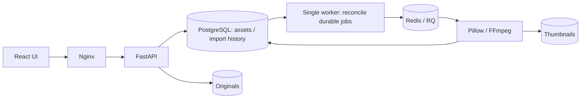

# AI Media Organizer

คลังรูปและวิดีโอส่วนตัวตาม [PLAN.md](PLAN.md) สำหรับใช้งานบนเครื่องหรือเซิร์ฟเวอร์ที่ควบคุมเอง

**สถานะ: เริ่มพัฒนาช่วง A แล้ว** — นำเข้า เก็บต้นฉบับ ตรวจไฟล์ซ้ำ สร้าง thumbnail และติดตามคิวได้ ส่วน OCR, AI จัดหมวด, semantic search และค้นหาช่วงวิดีโอเป็นช่วง B/C ซึ่งยังไม่ได้พัฒนา

## เริ่มใช้งาน

ต้องมี Docker Engine และ Docker Compose v2

```sh
cp .env.example .env
docker compose up --build -d
```

เปิด http://localhost:8080 แล้วเลือกไฟล์ได้ครั้งละไม่เกิน 50 ไฟล์ รองรับ JPEG/PNG/WebP และ MP4/MOV ขนาดไม่เกิน **250 MiB ต่อไฟล์** วิดีโอต้องใช้ codec ที่ FFmpeg อ่านได้; ไม่รองรับ HEIC, RAW, GIF หรือไฟล์เสียงในรุ่นนี้ ไฟล์เสียจะปรากฏเป็นงานล้มเหลวและกดลองใหม่ได้

สำหรับ Codex cloud ที่ต้องใช้ proxy CA:

```sh
docker compose -f compose.yaml -f compose.cloud.yaml up --build -d
```

หน้าเว็บผูกกับ `127.0.0.1` เท่านั้น ยังไม่มีระบบ login จึงต้องเพิ่ม authentication, authorization และ HTTPS ก่อนเปิดผ่านอินเทอร์เน็ตหรือนำข้อมูลส่วนตัวไปใช้งานนอกเครื่อง

## ทำงานอย่างไร



- SHA-256 ของเนื้อหาเป็น unique key นำเข้าไฟล์เดิมด้วยชื่ออื่นจะบันทึกประวัติการนำเข้าใหม่โดยอ้างอิงต้นฉบับเดิม
- ไม่แก้ ย้าย หรือลบไฟล์ต้นทางบนเครื่องผู้ใช้ ต้นฉบับที่นำเข้าถูกเก็บแยกจาก thumbnail
- API บันทึกงานลง PostgreSQL ก่อน worker ส่งงานเข้า Redis จึงกู้คิวได้หาก Redis สูญหายหรือ API หยุดก่อน enqueue
- รุ่น A ใช้ worker **หนึ่งตัวเท่านั้น ห้าม scale worker** เพราะ worker จะกู้งานที่ค้างจาก process เดิมเมื่อเริ่มใหม่ งานถูกขัดจังหวะลองใหม่ได้ไม่เกิน 3 ครั้ง; ไฟล์เสียต้องกด retry เอง
- สถานะและจำนวนครั้งเก็บใน `media_assets` ก่อนแยก `processing_jobs` เมื่อมีหลายขั้นวิเคราะห์ในช่วง B
- อ่านวันที่ถ่ายจาก EXIF DateTimeOriginal หากมี โดยเก็บเป็นเวลาในกล้องที่ไม่มี timezone; ถ้าไม่ทราบจะแสดงว่าไม่ทราบ และแยกวันที่นำเข้าไว้เสมอ วิดีโอยังไม่อ่านวันที่ถ่ายในช่วง A
- เก็บเวอร์ชัน pipeline (`thumbnail-v1`) งานที่เสร็จแล้วจะไม่สร้าง thumbnail ซ้ำ
- ไม่มีการเรียก AI API หรือส่งสื่อให้บริการภายนอก
- รายการคลังแสดงสูงสุด 1,000 ไฟล์ในช่วงนี้; pagination, อัลบั้ม และตัวกรองวันที่จะเพิ่มภายหลัง

## API

หากพัฒนา backend โดยตรง เปิดเอกสาร API ได้ที่ `http://localhost:8000/docs`

| Endpoint | หน้าที่ |
| --- | --- |
| `GET /api/health` | ตรวจ API/DB และอ่านขีดจำกัด |
| `POST /api/imports` | รับ multipart field `files` หลายไฟล์ พร้อมรายงานรายไฟล์ |
| `GET /api/assets` | คลังสื่อและสถานะ |
| `GET /api/assets/{id}` | รายละเอียด |
| `GET /api/assets/{id}/thumbnail` | ภาพตัวอย่าง |
| `GET /api/assets/{id}/original` | ต้นฉบับ |
| `POST /api/assets/{id}/retry` | เริ่มงานที่ล้มเหลวใหม่ |

## พัฒนาและทดสอบ

Python 3.12+, Node 24 และ FFmpeg/ffprobe ต้องอยู่ใน PATH

```sh
python -m venv .venv
.venv/bin/pip install -r backend/requirements.txt
PYTHONPATH=backend .venv/bin/pytest backend/tests -q
npm --prefix frontend ci
npm --prefix frontend run build
```

Tests ใช้ฐานข้อมูลชั่วคราว SQLite หากไม่กำหนด `DATABASE_URL` หากต้องการตรวจ PostgreSQL และ Redis จริง ให้กำหนด `DATABASE_URL` ไปฐานข้อมูลทดสอบแยก และ `TEST_REDIS_URL=redis://localhost:6379/15` ก่อนรัน pytest **ห้ามใช้ฐานข้อมูลจริง** เพราะ tests ล้างตารางและ Redis database ทดสอบ

GitHub Actions รัน tests ด้วย PostgreSQL/Redis และ build frontend ทุก push/PR

รันแบบไม่ใช้ Docker (แต่ต้องมี Redis สำหรับ worker):

```sh
# Terminal 1: API — ค่าเริ่มต้นใช้ SQLite ที่ ./data/media.db
PYTHONPATH=backend .venv/bin/uvicorn app.main:app --host 127.0.0.1 --port 8000 --no-access-log
# Terminal 2: worker (ใช้ DATA_DIR / DATABASE_URL เดียวกับ API)
PYTHONPATH=backend .venv/bin/python -m app.worker
# Terminal 3: UI + proxy ไป API
npm --prefix frontend run dev
```

## การเก็บข้อมูลและสำรอง

Docker named volumes `media`, `postgres`, `redis` เก็บข้อมูลถาวร `docker compose down` ไม่ลบข้อมูล หลีกเลี่ยง `down -v` หากต้องการรักษาคลังไว้

ก่อนใช้เป็นคลังหลัก ให้ทดสอบสำรองและกู้คืนทั้ง PostgreSQL และ media volume คู่กัน โดยหยุด API/worker ระหว่าง backup เพื่อให้ไฟล์และข้อมูลอ้างอิงตรงกัน รุ่นนี้ยังไม่มี backup อัตโนมัติหรือคำสั่งลบข้อมูล

`.gitignore` ตัด `.env`, `data`, database และไฟล์ชั่วคราวออกจาก Git ห้าม commit รูปส่วนตัว credentials หรือฐานข้อมูลจริง สื่อใน tests สร้างขึ้นเองด้วย Pillow/FFmpeg

ดูหลักฐานการตรวจและภาพหน้าจอใน [docs/VERIFICATION.md](docs/VERIFICATION.md)

## ขั้นถัดไป

1. ทดลองช่วง A ด้วยชุดสื่อตัวอย่างที่อนุญาต 100–300 ไฟล์ และวัดเวลาประมวลผล/พื้นที่
2. ช่วง B: เปรียบเทียบ OCR ไทย/อังกฤษและโมเดล embeddings ก่อนเลือก เพิ่มหมวด/แท็ก/การแก้ไข และ hybrid search
3. ช่วง C: เลือกเฟรมวิดีโอและค้นพร้อม timestamp
4. ช่วง D: เลือกวิธีนำเข้าจากมือถือเมื่อทราบ Android/iPhone และแหล่งเก็บไฟล์จริง

ดูรายละเอียดขอบเขตและเกณฑ์ผ่านใน [PLAN.md](PLAN.md)
