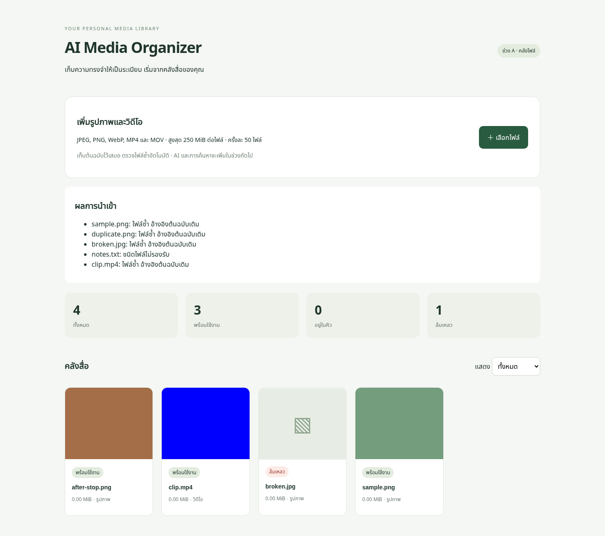
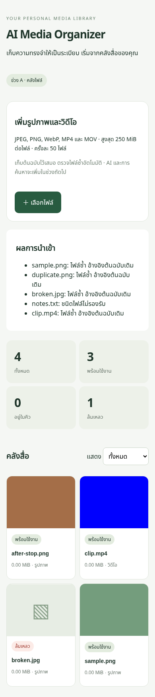

# Phase A verification

ทดสอบใน Codex cloud วันที่ 20 ตุลาคม 2026 ด้วยสื่อสังเคราะห์ที่สร้างเอง ไม่มีข้อมูลส่วนตัว

## User story

ผู้ใช้เลือกหลายไฟล์ใน React → Nginx ส่ง multipart ไป FastAPI → เก็บต้นฉบับ/ประวัติใน media volume และ PostgreSQL → worker กู้/จัดคิวใน Redis RQ → Pillow/FFmpeg สร้าง thumbnail → UI polling แสดงผลและเปิดต้นฉบับได้

| Boundary | Evidence |
| --- | --- |
| UI renders | Chromium desktop 1440px / mobile 390px, no JavaScript page errors, no horizontal overflow |
| UI → API | Uploaded PNG, same-content renamed PNG, corrupt JPG, unsupported TXT, MP4 through the file picker |
| API → storage | SHA-256 dedup returns one asset plus separate import history; original response bytes match uploaded PNG |
| Queue → processing | PNG/MP4 reach ready; corrupt JPG reaches failed without blocking the batch |
| Processing → UI | Thumbnails visible; video filter returns only video; detail dialog shows unknown capture date and closes with Escape |
| Persistence | Imported while worker stopped, restarted worker, asset reached ready; restarted API/PostgreSQL/Redis and asset remained accessible |
| Recovery | Integration test clears dedicated Redis DB, reconciles pending PostgreSQL jobs, simulates interrupted started job, resumes processing |

## Repeatable checks

- Backend tests: PostgreSQL 17 / Redis 7.4 integration (`TEST_REDIS_URL`), including dedup, corrupt files, retry, limits, original bytes, generated video thumbnail, durable recovery.
- Frontend: TypeScript check and Vite production build.
- Dependency checks: `npm audit` and `pip-audit -r backend/requirements.txt`.
- Docker: full Compose build and startup with DB/API health checks.

Browser smoke tests and restart checks were run manually with Playwright/Chromium and Docker Compose. CI runs backend integration tests and frontend build; browser automation is not yet part of CI.

## Limits of this result

This verifies the Phase A flow with generated samples. It does not establish search quality, OCR accuracy, AI categorization, codec compatibility across all devices, performance at 100–300 real files, or production security. Single worker only. Thai/English search evaluation belongs to Phase B.
